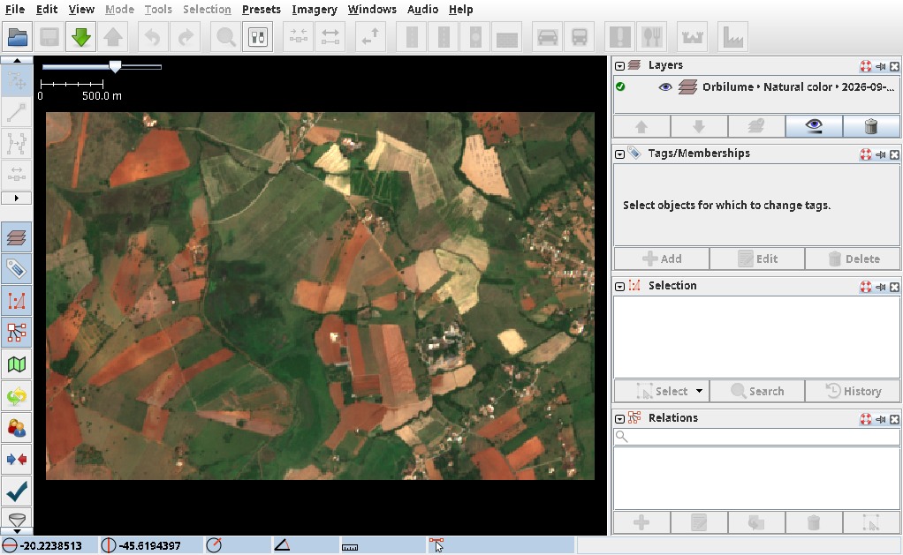

<p align="center">
  
</p>
<h1 align="center">Orbilume</h1>
<p align="center">Find, preview, and compare Sentinel-2 imagery in JOSM.</p>
<p align="center">
  <a href="https://github.com/erickfaria/orbilume/releases/latest">Download</a> ·
  <a href="docs/User-Guide.md">User guide</a> ·
  <a href="docs/Sources-and-Licenses.md">Sources and licenses</a> ·
  <a href="https://github.com/erickfaria/orbilume/wiki">Wiki</a> ·
  <a href="https://github.com/erickfaria/orbilume/issues">Support</a>
</p>



*Contains modified Copernicus Sentinel data 2026, accessed through Earth Search (Element 84).*

## What you can do

Orbilume is a free, independent tool for collaborative mapping. It gives contributors a way to find recent available Sentinel-2 imagery, compare dates, and resolve questions about what they see before drawing manually in JOSM.

- Set an area of interest (AOI) from the map view, selected objects, or a bounding box. Search Sentinel-2 Level-2A scenes by date and scene-wide cloud cover.
- Preview an Earth Search crop in natural color and estimate cloud, cloud shadow, and valid coverage within the AOI before loading a full composition.
- View natural color, near-infrared vegetation, or shortwave-infrared soil and vegetation. Compare two Earth Search dates in one layer without moving the map when switching dates.

## Install

Use **JOSM r19369 or later** and **Java 17 or later**. Download [`orbilume.jar`](https://github.com/erickfaria/orbilume/releases/latest/download/orbilume.jar) and copy it into the JOSM plugins directory, keeping the filename. On a standard Debian installation, the directory is `${XDG_DATA_HOME:-$HOME/.local/share}/JOSM/plugins`.

Restart JOSM, enable **orbilume** in **Preferences → Plugins**, and restart again if prompted. Or install **orbilume** directly from the [JOSM plugin catalog](https://josm.openstreetmap.de/wiki/PluginsSource#Orbilume).

## Quick start

1. Open **Imagery → Orbilume**. Choose **Use map view** or **Use selection**.
2. Choose a provider, set the date range and scene cloud limit, then click **Search**.
3. With **Earth Search**, select one scene and click **Preview AOI**. Choose a composition and click **Load imagery**, or select two acquisitions and click **Compare dates**.
4. Right-click the comparison layer and choose **Switch to [date]** to toggle the image while keeping your map view.

Earth Search crops and comparison layers use Web Mercator (EPSG:3857). See the [user guide](docs/User-Guide.md) for the cloud estimate, band combinations, provider limits, and troubleshooting.

## Build

Use JDK 21 and a JOSM JAR. The build targets Java 17 and produces `build/orbilume.jar`.

```sh
./build.sh
JOSM_JAR=/path/to/josm.jar ./build.sh
```

## Sources and licenses

Orbilume displays only Copernicus Sentinel-2 Level-2A imagery, accessed through Earth Search or EOPF Explorer. Read the [original licenses, provider documentation, and privacy details](docs/Sources-and-Licenses.md), also linked from **Sources & licenses** in the plugin.

Orbilume is distributed under [GNU GPL v3](LICENSE). The [Copernicus Sentinel Data Legal Notice](https://cds.climate.copernicus.eu/licences/ec-sentinel) governs the imagery. JOSM handles drawing and any later submission to OpenStreetMap.
