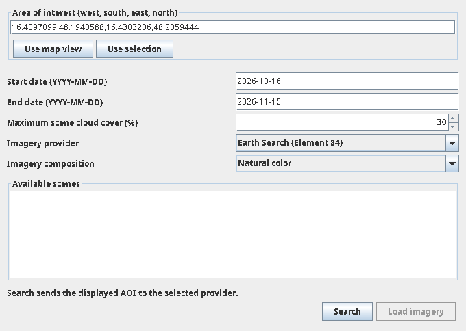

# Orbilume User Guide

## Search and load imagery

Use **Imagery → Orbilume**. The area of interest can come from the viewport, a selection's bounding rectangle, or a pasted bounding box. Use decimal degrees in west, south, east, north order, with commas between values. Dates use `YYYY-MM-DD`.

| Composition | Red, green, blue channels | Use |
| --- | --- | --- |
| Natural color | B04, B03, B02 | Visual context and interpretation |
| Vegetation (near infrared) | B08, B04, B03 | Contrast between vegetation and other surfaces |
| Soil and vegetation (SWIR) | B12, B8A, B04 | Compare exposed soil and vegetation |

Select a scene and click **Load imagery**. Use the Layers panel to hide or remove the imagery. Inspect multiple dates before interpreting changes in vegetation or drawing land-use boundaries.

## Coverage and clouds

- **Earth Search** loads a crop within the searched rectangle. Use Web Mercator (EPSG:3857). A crop can be up to 2,048 pixels per side.
- **Copernicus EOPF Explorer** loads imagery tiles through JOSM. Tiles can extend beyond the search rectangle, and coverage depends on the provider's catalog.
- Search displays up to 20 scenes, with lower reported cloud cover first. Scenes without valid cloud metadata are excluded. The percentage describes the full scene and no per-pixel cloud mask is applied.

If a search is empty, try a longer historical date range, a higher cloud limit, or Earth Search. If a crop is too large, zoom in and update the area from the map view. For a blank Earth Search layer, verify that JOSM is set to Web Mercator and check the scene's coverage.

## Network and privacy

Search sends the area rectangle, dates and cloud limit to the chosen catalog. JOSM object IDs, tags and edit contents stay in the editor. Earth Search imagery is read over HTTPS from fixed public hosts, with checks on the asset path, redirects, dimensions and bytes read. Crops are decoded locally in memory. EOPF tiles use JOSM's imagery cache and proxy settings.

- [Earth Search](https://github.com/Element84/earth-search)
- [Sentinel-2 open data](https://registry.opendata.aws/sentinel-2-l2a-cogs/)
- [Copernicus EOPF Explorer](https://explorer.eopf.copernicus.eu/)
