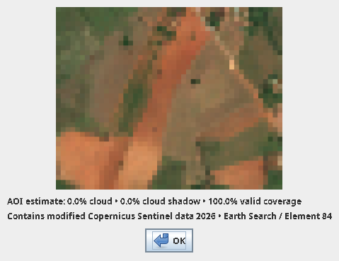

# Orbilume user guide

## Find a scene

Open **Imagery → Orbilume**. Set the area of interest (AOI) from the map view, a selection's bounding rectangle, or a pasted box. Enter coordinates in **west, south, east, north** order, in decimal degrees. Dates use `YYYY-MM-DD`.

Set the provider, dates and maximum scene cloud cover, then click **Search**. Up to 20 scenes are shown, with the least cloudy scenes first. Scenes without a valid cloud percentage are excluded. Changing the AOI or search filters clears results, so the next operation uses the displayed search.

## Preview the AOI

Select one Earth Search scene and click **Preview AOI**. The dialog shows a reduced natural-color crop, at most 384 pixels per side, and estimates from the Sentinel-2 Level-2A Scene Classification Layer (SCL).

- **Cloud** counts medium- and high-probability cloud and thin cirrus (SCL 8–10).
- **Cloud shadow** counts SCL 3 separately.
- **Valid coverage** is the proportion of the sampled AOI with a valid SCL class. Pixels outside the scene, no-data pixels and defective pixels are excluded from the cloud and shadow percentages. Unclassified pixels are included in valid coverage.

The estimate uses samples across the rectangular AOI. It is separate from the catalog's scene-wide percentage. It may miss small clouds, particularly in large AOIs. If the scene lacks a readable SCL band, the preview reports that AOI cloud coverage is unavailable.

[Copernicus Sentinel-2 classification documentation](https://sentiwiki.copernicus.eu/web/s2-processing)

## Load a composition

| Composition | Red, green, blue channels | Typical use |
| --- | --- | --- |
| Natural color | B04, B03, B02 | Visual context |
| Vegetation (near infrared) | B08, B04, B03 | Distinguish vegetation from other surfaces |
| Soil and vegetation (SWIR) | B12, B8A, B04 | Compare exposed soil and vegetation |

Select one scene, choose a composition and click **Load imagery**. The imagery appears as a layer in JOSM. Hide or remove it from the Layers panel.

## Compare two dates

1. Search **Earth Search** over the same AOI and select two rows from different acquisition dates with Ctrl-click (Cmd-click on macOS) or Shift-click.
2. Choose one composition and click **Compare dates**. Both dates are loaded into a single layer on the same AOI and grid.
3. Right-click the comparison layer in the Layers panel and choose **Switch to [date]**. The layer name shows the displayed date. Switching keeps your map position and zoom.

Look for boundaries that persist across dates. Seasonal color changes, shadows, and changes in exposure can make fields look different.

## Provider limits and troubleshooting

| Provider | Imagery loading | AOI preview and date comparison |
| --- | --- | --- |
| Earth Search (Element 84) | A crop within the AOI, up to 2,048 pixels per side. Use Web Mercator (EPSG:3857). | Available |
| Copernicus EOPF Explorer | JOSM imagery tiles, which can extend beyond the AOI. | Use Earth Search for these features |

- **Empty search** — Try a longer date range, a higher scene cloud limit, or Earth Search.
- **Crop too large** — Zoom in and click **Use map view** again, or select a smaller bounding box.
- **No pixels or partial coverage** — Choose a scene that covers more of the AOI. A catalog result can intersect only part of the rectangle.
- **Layer invisible** — Check that the layer is visible, the map is over the AOI, and the projection is Web Mercator for Earth Search.
- **Network error** — Check your connection. If the provider is rate-limiting requests, wait before trying again. Closing the search dialog cancels pending work.

## Sources, licenses, and privacy

Click **Sources & licenses** in the dialog, or read [Sources, licenses, and privacy](Sources-and-Licenses.md) for the original terms and details about what each provider receives.
